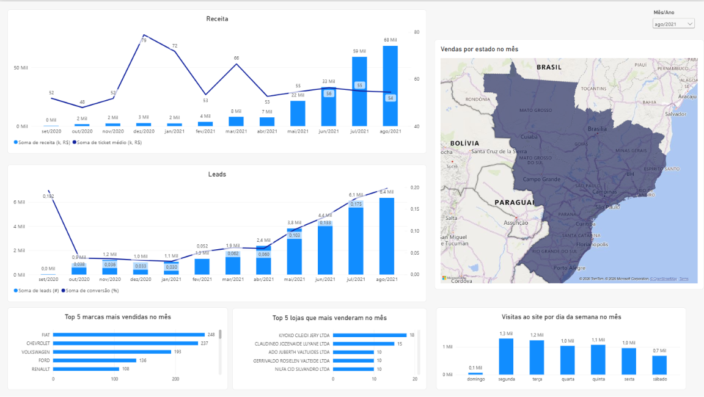
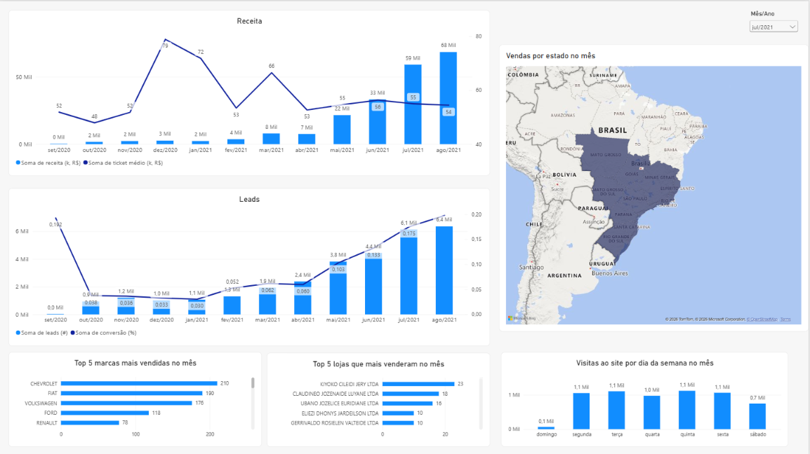

# Dashboard de Vendas | PostgreSQL + Power BI

Dashboard interativo de acompanhamento de vendas, construído com consultas SQL no **PostgreSQL** e visualizações no **Power BI**. Projeto desenvolvido a partir de um curso de dados, com um diferencial: **filtro por mês/ano** que atualiza os rankings e o mapa.

## Preview





## Diferencial: filtro por mês/ano

No curso, as consultas fixam o mês de agosto/2021. Neste projeto, as consultas trazem **todos os meses** e o Power BI faz o recorte:

- Uma segmentação de **Mês/Ano** atualiza o mapa de vendas por estado, o Top 5 de marcas, o Top 5 de lojas e as visitas por dia da semana.
- Os gráficos de receita e de leads mostram sempre a série histórica completa.
- O Top 5 é feito no próprio Power BI (filtro N superior), e não na query.

## Perguntas de negócio

| Visual | Pergunta que responde |
|---|---|
| Receita + ticket médio | Como a receita e o valor médio por venda evoluíram mês a mês? |
| Leads + conversão | Quantos leads entraram por mês e qual % virou venda? |
| Vendas por estado | De onde vêm as vendas? Onde estão concentradas? |
| Top 5 marcas | Quais marcas mais vendem no mês selecionado? |
| Top 5 lojas | Quais lojas parceiras mais vendem no mês selecionado? |
| Visitas por dia da semana | Em quais dias o site tem mais tráfego? |

## Insights

<!-- Confira os números no seu dashboard antes de publicar -->

- Os leads cresceram de cerca de 1,1 mil (jan/2021) para cerca de 6,4 mil (ago/2021), um aumento de aproximadamente 6 vezes.
- A taxa de conversão subiu de cerca de 3% para cerca de 20% no mesmo período.
- A receita mensal em ago/2021 é cerca de 30 vezes a de jan/2021.
- Em ago/2021, Fiat e Chevrolet foram as marcas mais vendidas e São Paulo concentrou a maior parte das vendas.

## Tecnologias

- PostgreSQL (CTEs, joins entre 4 tabelas, agregações, `date_trunc`, `extract`, `case`)
- Power BI (conexão direta com o banco, modelagem de relacionamentos, segmentação, gráficos combinados, mapa coroplético)
- Git e GitHub

## Estrutura do repositório

```
Dashboard-de-Vendas/
├── README.md
├── queries/
│   ├── 01_receita_leads_mensal.sql
│   ├── 02_estados_vendas.sql
│   ├── 03_marcas_vendas.sql
│   ├── 04_lojas_vendas.sql
│   └── 05_visitas_dia_semana.sql
├── dashboard/
│   └── Dashboard de vendas.pbix
└── imagens/
    ├── aug-21.png
    └── jul-21.png
```

## Como abrir o dashboard

Baixe o arquivo `Dashboard de vendas.pbix` da pasta `dashboard/` e abra no **Power BI Desktop** (gratuito). Os dados já estão importados no arquivo, então os filtros e o seletor de mês/ano funcionam sem precisar do banco de dados. As consultas SQL usadas estão na pasta `queries/`.

## Aprendizados

- Modelar relacionamentos entre tabelas para que uma única segmentação filtre vários visuais.
- Aplicar o filtro N superior (Top 5) e ordenar eixos por outra coluna (dias da semana de domingo a sábado).
- Configurar a categoria de dados de uma coluna para o mapa reconhecer os estados.

## Sobre os dados

A base de dados é do curso. O arquivo `.pbix` na pasta `dashboard/` contém os dados importados para o Power BI.

## Autora

**Gabriela Vasconcelos**

[LinkedIn](https://www.linkedin.com/in/gabriela-dos-santos-vasconcelos-227727302/) · [GitHub](https://github.com/gabi-vasconcelos)
